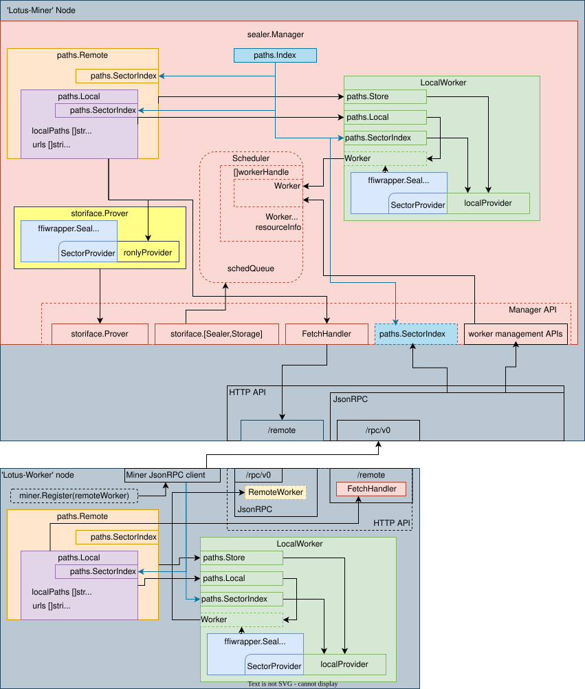

# Qoin Sector Storage

This module provides the sector storage subsystem used by Qoin Shor. It builds on
the Filecoin Project's [sector-storage](https://github.com/filecoin-project/sector-storage)
implementation of the [specs-storage](https://github.com/filecoin-project/specs-storage)
interface.

## Upstream Attribution

The original sector-storage project was developed by Protocol Labs and Filecoin
Project contributors. The following badges refer to the upstream project, not to
Qoin authorship or the build status of this repository.

## Disclaimer

Please report issues with Qoin's sector storage module at the
[Qoin Shor issue tracker](https://github.com/post-quantumqoin/qoin-shor/issues).

## Architecture

### `Manager`

Manages is the top-level piece of the storage system gluing all the other pieces
together. It also implements scheduling logic.

### `package paths`

This package implements the sector storage subsystem. Fundamentally the storage
is divided into `path`s, each path has it's UUID, and stores a set of sector
'files'. There are currently 5 types of sector files - `unsealed`, `sealed`, `cache`, `update` and `update-cache`.

Paths can be shared between nodes by sharing the underlying filesystem.

### `paths.Local`

The Local store implements SectorProvider for paths mounted in the local
filesystem. Paths can be shared between nodes, and support shared filesystems
such as NFS.

stores.Local implements all native filesystem-related operations 

### `paths.Remote`

The Remote store extends Local store, handles fetching sector files into a local
store if needed, and handles removing sectors from non-local stores.

### `paths.Index`

The Index is a singleton holding metadata about storage paths, and a mapping of
sector files to paths

### `LocalWorker`

LocalWorker implements the Worker interface with ffiwrapper.Sealer and a
store.Store instance

## License

The upstream Filecoin Project sector-storage implementation is dual-licensed under
Apache 2.0 and MIT terms:

- Apache License, Version 2.0, ([LICENSE-APACHE](https://github.com/filecoin-project/sector-storage/blob/master/LICENSE-APACHE) or http://www.apache.org/licenses/LICENSE-2.0)
- MIT license ([LICENSE-MIT](https://github.com/filecoin-project/sector-storage/blob/master/LICENSE-MIT) or http://opensource.org/licenses/MIT)

For this repository's license texts, see [LICENSE-APACHE](../../LICENSE-APACHE)
and [LICENSE-MIT](../../LICENSE-MIT). Qoin branding does not replace upstream
copyright notices or applicable license terms.
